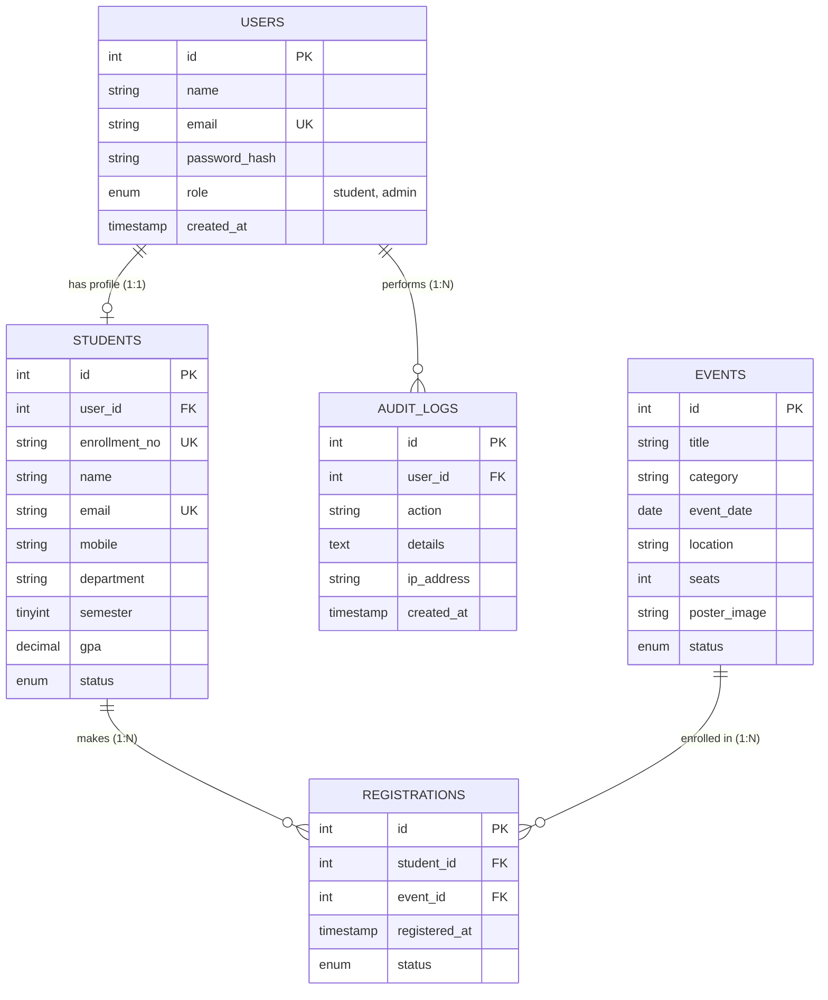

# Practical 8: Entity-Relationship (ER) Model & Database Normalization

**Course:** Web Development Frameworks (ITUE203)  
**Database Name:** `studenthub`  

---

## 1. Entity-Relationship Diagram

---

## 2. Normalization Analysis (1NF &rarr; 2NF &rarr; 3NF)

1. **First Normal Form (1NF):**
   - Every column contains atomic (indivisible) values. No repeating groups or comma-separated lists of courses or events.
   - Each table defines a distinct primary key (`id`).
2. **Second Normal Form (2NF):**
   - The schema is in 1NF.
   - All non-key attributes are fully functionally dependent on the entire primary key.
   - The Many-to-Many relationship between `students` and `events` is decomposed into the associative entity `registrations` with foreign keys.
3. **Third Normal Form (3NF):**
   - The schema is in 2NF.
   - There are no transitive dependencies (no non-key attribute depends on another non-key attribute).
   - User security credentials reside in `users`, academic records in `students`, event metadata in `events`, preventing update and deletion anomalies.
